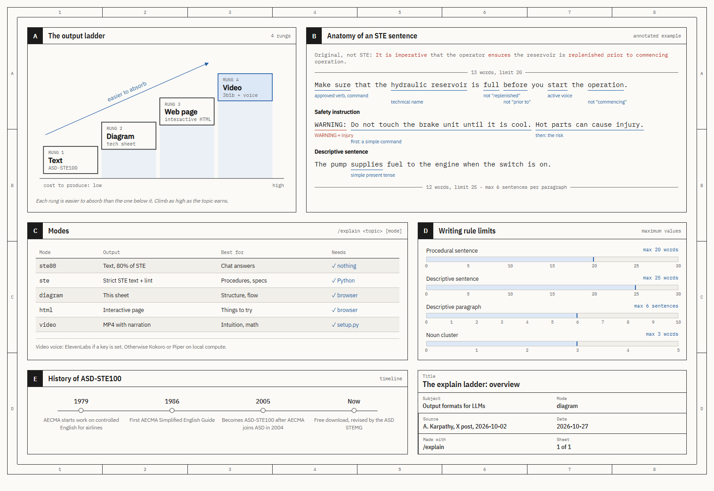
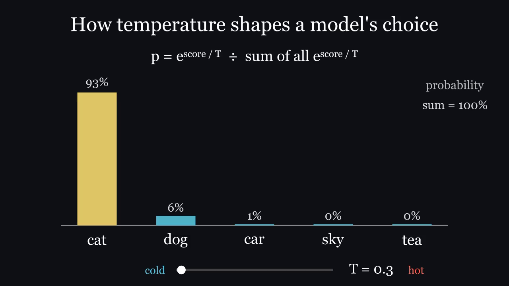

# /explain: Karpathy's output ladder as a Claude Code skill

> "As LLMs get better, they will do more and more of the legwork autonomously, and a lot more of our work
> will rise up the abstractions into oversight and understanding."
> — [Andrej Karpathy](https://x.com/karpathy), X post, 2 Oct 2026

Karpathy's post gives a ladder of output formats for understanding what models produce. Each rung is
easier to absorb than the one below it. This skill implements all four rungs in Claude Code and installs
with one command.



| Rung | Mode      | You get                                                     | Best for                          |
|------|-----------|-------------------------------------------------------------|-----------------------------------|
| 1    | `ste80`   | Text "80% of the way" to ASD-STE100 (the default)           | Normal answers                    |
| 1    | `ste`     | Strict ASD-STE100 text, checked by a linter                 | Procedures, specs                 |
| 2    | `diagram` | An engineering-drawing "technical sheet" (HTML + SVG)       | Structure, flows, comparisons     |
| 3    | `html`    | An interactive single-file web page                         | Things with knobs and steps       |
| 4    | `video`   | A 3Blue1Brown-style MP4 with narration and subtitles         | Intuition, math, algorithms       |

Video narration uses **ElevenLabs** if you set `ELEVENLABS_API_KEY`. Without a key it uses free voices that
run on your own CPU: **Kokoro** (English and 7 other languages) and **Piper** (Russian, Ukrainian, German,
Polish, and more).

## Install (one command)

```bash
npx skills add undefined-ui/explain-skill -g
```

That is all. It works on macOS, Linux and Windows (Node.js 22.20+), through the
[skills](https://github.com/vercel-labs/skills) CLI. Restart Claude Code after you install.

Text, diagram and HTML modes work at once. The first time you ask for a video, Claude tells you that video
mode needs a one-time download (about 400 MB: [uv](https://docs.astral.sh/uv/), Python 3.12, Manim, Kokoro,
Piper), then sets it up by itself. No ffmpeg and no LaTeX needed.

<details>
<summary>Other ways to install (video ready in advance, no Node.js, or as a plugin)</summary>

Install the skill and set up video mode in one step:
```bash
curl -fsSL https://raw.githubusercontent.com/undefined-ui/explain-skill/main/install.sh | bash
```
```powershell
irm https://raw.githubusercontent.com/undefined-ui/explain-skill/main/install.ps1 | iex
```
Add `-s -- --no-video` after `bash`, or set `$env:EXPLAIN_NO_VIDEO = 1` first, to skip the video setup.

As a Claude Code plugin:
```
/plugin marketplace add undefined-ui/explain-skill
/plugin install explain@explain-skill
```
</details>

## Use

```
/explain how a TCP handshake works diagram
/explain this repo's auth flow html
/explain why softmax has a temperature video
/explain how to rotate the API keys ste
```

Or just ask: "explain X as a diagram", "make an interactive page about X", "make a 3b1b style video about X",
"rewrite this in ASD-STE100". With no mode, the skill picks the highest rung the topic earns and says which.

Every output goes to `explainers/<topic>/` in your current folder and opens when it is done.

### ElevenLabs narration

```bash
export ELEVENLABS_API_KEY=sk_...               # PowerShell: $env:ELEVENLABS_API_KEY = "sk_..."
export ELEVENLABS_VOICE_ID=JBFqnCBsd6RMkjVDRZzb  # optional, any voice id from your library
export ELEVENLABS_MODEL=eleven_multilingual_v2   # optional
```

The key is read from the environment only. It is never written to a file.

## How each rung works

**1. ASD-STE100.** ASD-STE100 is a controlled language made for aircraft maintenance manuals: about 900
approved words, one meaning each, sentences of 20 words or fewer for steps, active voice, no -ing forms.
The skill carries a working summary of the rules ([`references/ste100.md`](skills/explain/references/ste100.md))
and a linter ([`scripts/ste_lint.py`](skills/explain/scripts/ste_lint.py)) for strict mode. `ste80` keeps the
rules that make text easy to read and relaxes the ones that cost meaning, as Karpathy suggests.

Simplified text has one known failure mode: it can quietly drop facts. So every mode has a hard rule:
**keep every fact**, and compare the output with the source before you hand it over.

**2. Diagram.** A technical sheet in the style of an engineering drawing: zone border, lettered panels,
blue callouts, red for "not this", a title block. One HTML file with inline SVG. It prints on A3, supports
dark mode, and stacks on a phone. Template: [`assets/sheet-template.html`](skills/explain/assets/sheet-template.html).

**3. HTML.** One self-contained page with real interaction: sliders that drive the real math, step-through
controls, hover definitions. No build step.

**4. Video.** Claude writes the script as `narration.json`, then:

```
narration.json ──tts.py──▶ audio/*.wav + manifest.json (exact durations)
                                   │
scene.py (Manim) ──narrate.py──────┘  every animation block is timed to its voice clip
        │
        └──render.py──▶ topic.mp4 + topic.srt + stills/*.png  ──▶ Claude checks the stills, fixes, renders again
```

Claude looks at the stills before it reports, so it catches overlapping text and leftover shapes itself.
A complete example lives in [`assets/video/example/`](skills/explain/assets/video/example/).

[](docs/demo-softmax-temperature.mp4)

The example above: 37 seconds, voiced by Kokoro on a laptop CPU, bars computed with the real softmax.
[Watch the MP4](docs/demo-softmax-temperature.mp4).

## What is installed where

| Path                              | What                                                  |
|-----------------------------------|-------------------------------------------------------|
| `~/.claude/skills/explain/`       | The skill: `SKILL.md`, references, scripts, templates |
| `~/.cache/explain-skill/venv/`    | Python 3.12 with Manim, Kokoro, Piper                 |
| `~/.cache/explain-skill/models/`  | Kokoro model; Piper voices download on first use      |

Check the setup at any time: `python ~/.claude/skills/explain/scripts/doctor.py`.

**Uninstall:** `npx skills remove --global explain`, then delete `~/.cache/explain-skill`.
(Installed with the script instead? Delete `~/.claude/skills/explain` and `~/.cache/explain-skill`.)

**Linux note:** Manim needs Cairo and Pango headers:
`sudo apt install build-essential python3-dev libcairo2-dev libpango1.0-dev pkg-config`.

## По-русски

Скилл для Claude Code по посту Карпати: объяснение в четыре ступени. Текст на ASD-STE100, схема в виде
технического листа, интерактивная HTML-страница и видео в стиле 3Blue1Brown с озвучкой. Ставится одной
командой: `npx skills add undefined-ui/explain-skill -g`. Видео-режим докачивается сам при первом запросе
(около 400 МБ, Claude сначала спросит). Без ключа ElevenLabs голос генерируется локально и бесплатно: английский через Kokoro,
русский через Piper (`"lang": "ru"` в `narration.json`). Просто напишите: «объясни X через схему»,
«сделай интерактивную страницу про X», «сделай видео-объяснение про X».

## Credits

- Idea and the ladder: [Andrej Karpathy](https://x.com/karpathy).
- [ASD-STE100](https://www.asd-ste100.org/) is a specification of ASD. This repo has its own summary of the
  rules, not the specification. Get the official text free from asd-ste100.org.
- [Manim Community](https://www.manim.community/), [kokoro-onnx](https://github.com/thewh1teagle/kokoro-onnx),
  [Piper](https://github.com/OHF-Voice/piper1-gpl), [ElevenLabs](https://elevenlabs.io/).
- The video style is inspired by [3Blue1Brown](https://www.3blue1brown.com/). This project is not affiliated
  with 3Blue1Brown, Andrej Karpathy, ASD, or ElevenLabs.

MIT License.
