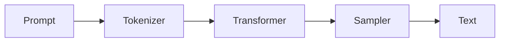

# Mode `diagram`: the technical sheet

Karpathy: "Instead of writing, ask your LLM to create a diagram. These can be a lot easier to process,
parse, and understand."

The output is one HTML file that looks like an engineering drawing sheet: a zone border (1-8, A-D),
lettered panels, blue annotations, red for "not this", and a title block. It prints on A3 landscape,
works in light and dark mode, and stacks to one column on a phone.

## Workflow

1. **Find the structure first.** Before you draw, write down (for yourself, not the user):
   - What are the parts? (nouns)
   - How do they connect? (verbs, arrows)
   - What is the one thing the reader must see? That goes in panel A, top left, biggest.
2. **Plan 4-6 panels.** One question per panel. Typical set:
   - **A** Structure or flow: the main figure (inline SVG).
   - **B** Anatomy: one real example, annotated with callouts.
   - **C** Comparison or reference table (`table.spec`, with `.ok` / `.no` marks).
   - **D** Numbers: limits, sizes, costs as gauges (`.gauge`).
   - **E** Sequence: timeline or numbered steps.
   - **F** Title block: title, subject, source, date, sheet number. Always keep it.
3. **Copy the template:** `assets/sheet-template.html` → `explainers/<slug>/diagram.html`.
   Keep the `<style>` block, the frame, and the components. Replace the sample panels.
   Change `<title>` to a 2-4 word name.
4. **Draw panel A as inline SVG** with hand-placed coordinates. Use the classes from the template:
   `.box` (part), `.key` (the important part, blue fill), `.thin` (lines), `.lead` (blue leader/arrow),
   `.ann` (blue annotation text), `.mono` (small grey labels). Use `marker-end="url(#arrow)"` for arrows.
5. **Open the file** and look at it. Fix every overlap, clipped label, and arrow that crosses a box.

## Panel span rules

The panel grid has 12 columns. Use `s4`, `s5`, `s6`, `s7`, `s8`, `s12` classes. Each row must sum to 12.
Below 980 px wide, every panel takes the full width.

## Drawing rules

- **One idea per panel.** If a panel needs a paragraph to explain it, split it into two panels.
- **Labels are words in STE-80.** Short, specific, active. "Sends token", not "Token is sent".
- **Show a real example.** Use a real command, real number, real file name from the source. Never "foo/bar".
- **Annotate, do not caption.** Point at the exact part with a leader line or an underline callout
  (`<span class="m" data-n="label">`). Use `.lo` to drop a label one row when two labels collide.
- **Color has meaning.** Black = structure. Blue = annotation or the key part. Red = wrong or "not this".
  Do not add other colors.
- **Text in SVG:** set `font-size` on each `<text>`, keep it 9-15. Leave 8 px clear around every label.
  Estimate width as 0.6 × font-size × characters; make sure it fits inside its box.
- **No decoration.** No gradients, shadows, icons, or emoji.

## SVG patterns

Box with label:
```svg
<g transform="translate(40,60)">
  <rect class="box" width="140" height="48"/>
  <text x="12" y="20" font-size="14" font-weight="600">Tokenizer</text>
  <text class="mono" x="12" y="37" font-size="10">text → ids</text>
</g>
```

Arrow between boxes, with a label above it:
```svg
<line class="lead" x1="180" y1="84" x2="240" y2="84" marker-end="url(#arrow)"/>
<text class="ann" x="210" y="76" font-size="11" text-anchor="middle">ids</text>
```

Tree connector (parent at top, children below):
```svg
<path class="thin" d="M200,60 V80 M90,80 H310 M90,80 V96 M310,80 V96"/>
```

## Quick option: Mermaid

For a fast answer inside chat, a Mermaid block is fine:



After it, offer the full sheet in one line.
